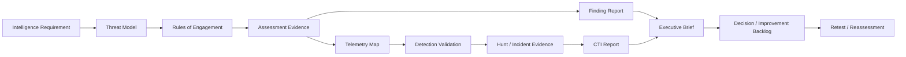

# 第0章　本書の読み方

## この章の位置付け

本書は、攻撃手法を順番に覚える本ではない。攻撃者の行動を理解し、許可された範囲で評価し、観測・検知・対応・分析・意思決定へつなげるための専門実務書である。

個々の技術は既存専門書と往復して学ぶ。本書では、分野間をつなぐ判断、証拠、成果物、責任、再評価を中心に扱う。

第0章では、読者が全30章を先頭から順に読むことを要求しない。現在の役割、解決したい問い、作成する成果物に応じて読書ルートを選び、必要な詳細へ進む。

## 学習目標

この章を終えると、次を実行できる。

- 本書の対象読者と対象外を説明できる
- 自分の役割と目的に合う読書ルートを選ぶ
- 本文、実務成果物、機械検証層の役割を区別する
- 本書で作成する成果物の流れを説明する
- 演習可能な対象と禁止対象を区別する
- 既存専門書へ進み、本書の統合工程へ戻る方法を説明する
- `Learning Route Plan`を作成する

## 前提知識

Linux、TCP/IP、DNS、HTTP、Gitの基礎を前提とする。全てに熟達している必要はないが、少なくともインフラ、クラウド、Web、開発、運用のいずれかに実務経験があることを想定する。

不足部分は、ポータルのLinux、インフラ、認証、クラウド、コンテナ、Pentest、Incident Response、AI Agent関連書籍で補う。基礎技術を本書内で全面的に再説明しない。

## 1. 本書の対象と対象外

### 1.1 主な対象読者

- SOC、CSIRT、Detection Engineering、Threat Hunting、IR、DFIR、CTIの実務者
- Security Architecture、Cloud Security、Identity Security、Platform Securityの担当者
- Pentestや脆弱性管理の結果を、検知、改善、経営判断へ接続する担当者
- セキュリティへ役割を広げる、経験あるインフラ、SRE、DevOps、開発技術者
- CISO室、Security Program責任者、技術リスクを判断するCTO・CISO

### 1.2 本書の対象外

- コンピュータやネットワーク自体を初めて学ぶための入門書
- CTF解法集、Exploit Development、攻撃コマンドのカタログ
- 特定製品のGUIやCLIを網羅する操作手順書
- 法律相談や個別案件の法的判断の代替
- 実在組織や実在Actorへの無許可の調査・帰属

前提が不足する場合、本書を薄めて読むのではなく、必要な基礎を専門書で補ってから本書の成果物へ戻る。

## 2. 本書を構成する三つの層

本書は、読者向け説明と実務記録、機械検査を分離する。

| 層 | 主な内容 | 主な利用者 |
|---|---|---|
| 本文 | 概念、判断、根拠、反例、実務上の含意 | 全読者 |
| 実務成果物 | Template、完全合成Case、Checklist、Rubric | 実務者、教育担当、Reviewer |
| 機械検証層 | JSON、Schema、fixture、contract、回帰検査 | 保守者、実装者、支援Agent |

機械検査は、参照、版、状態、安全境界、公開面の漂流を検出するために使う。検査成功を、実環境の安全性、実行許可、人間の承認、Controlの有効性へ読み替えてはならない。

本文だけで中心論旨を理解できる。実務成果物は具体的な記録を作るときに使い、機械検証層は正本を保守・再利用するときに使う。

## 3. 六種類の読者ルート

### 3.1 インフラ・クラウド・Identity技術者

推奨順:

```text
第0〜8章
  → 第12〜17章
  → 第19〜22章
  → 第23〜29章
```

Web・APIの詳細は必要に応じて第11章と`pentest-learning-book`へ進む。認証・認可の詳細は`practical-auth-book`で補う。

### 3.2 開発・DevOps・SRE技術者

推奨順:

```text
第0〜8章
  → 第9〜17章
  → 第21〜22章
  → 第27〜29章
```

CI/CD、Supply Chain、Workload Identity、AI Agentを重点的に読む。クラウド・コンテナの実装は関連専門書で補う。

### 3.3 SOC・CSIRT・Detection担当

推奨順:

```text
第0〜8章
  → 第16〜22章
  → 第23〜26章
  → 第9〜15章
  → 第27〜29章
```

先にTelemetry、Detection、Hunt、Incident Response、DFIRを読み、その後に評価の成立条件とCTIへの接続を確認する。

### 3.4 IR・DFIR・CTI・分析担当

推奨順:

```text
第0〜7章
  → 第18〜26章
  → 第15〜17章
  → 第27〜29章
```

Evidenceの来歴、時刻、Coverage、代替仮説、確信度、帰属限界、用途別配布を重点的に読む。

### 3.5 AI Security・Agent担当

推奨順:

```text
第0〜6章
  → 第12〜17章
  → 第23〜29章
```

第27章だけを単独で読むのではなく、Identity、Supply Chain、Telemetry、Authority、Source評価を先に確認する。AI出力を新しいSourceや実行許可へ昇格させない。

### 3.6 CTO・CISO・Security Program責任者

推奨順:

```text
第0〜5章
  → 第7章
  → 第15章
  → 第19章
  → 第22〜29章
```

詳細手順を全て実行する必要はない。ただし、Rules of Engagement、Finding、Residual Risk、CTI Report、Executive Brief、Final Portfolioの品質を判定できることを目標にする。

## 4. 最初に使う入口

初回は次の順で進める。

1. [Quick Start](../quickstart.md)で、判断要求と証拠不足を一つずつ読む。
2. [最初の成果物](../cases/first-artifact-walkthrough.md)で、仮説、観測計画、Gap、次の判断を対応させる。
3. [第1章](01-integrated-discipline.md)で、各業務機能の責任とHandoffを確認する。
4. 必要な章と[成果物索引](../artifact-index.md)へ進む。
5. 全体を統合するときは[第29章](29-capstone-case-study.md)から元Artifactへ戻る。

Quick Startは初心者向け書籍ではない。専門実務書の記録体系へ最小単位から入るためのオンボーディングである。

## 5. 成果物の流れ

本書の学習単位は章ではなく成果物である。



一つの成果物だけを完成させても、全体としては不十分である。例えば、脆弱性を発見しても、実際の資産への影響、検知可能性、修正優先度、残存リスクが示されなければ、意思決定には使いにくい。

第29章の`ART-33 Final Security Decision Portfolio Index`は、成果物を一つの共通Statusへ変換するものではない。元の章が所有するStatus、Evidence、Owner、Review、Gap、Reassessmentへ戻るための索引である。

## 6. 本書でいう「演習」

演習は、次のいずれかに限定する。

- 合成文書・合成ログを使う分析
- 自己所有の隔離ラボ
- 明示的に演習用として提供された対象
- 架空組織・架空Campaignのケーススタディ

第三者の公開Webサイトは、公開されているからといって演習対象ではない。検索結果に表示されたサーバ、GitHub上で見つけたSecret、インターネット上の管理画面を試してはならない。

## 7. 既存専門書との往復

本書は、詳細手順を意図的に委譲する。

```text
本書で目的・判断・成果物を理解する
  → 専門書で詳細技術を学ぶ
  → 許可されたラボで検証する
  → 本書へ戻り、検知・分析・経営判断へ接続する
```

専門書を先に読み切る必要はない。現在の成果物を完成させるために必要な範囲を学び、統合工程へ戻る。

委譲先を読んだことは、実行許可、実施結果、Evidence取得を意味しない。委譲先から戻るときは、対象、版、必要条件、実行環境、結果、限界、復旧条件を本書の成果物へ記録する。

## 8. 学習記録

各章で、最低限次を記録する。

| 項目 | 内容 |
|---|---|
| Question | 何を判断しようとしたか |
| Scope | 対象と対象外 |
| Evidence | 何を観測したか |
| Assumptions | 何を仮定したか |
| Judgment | 何を判断したか |
| Confidence | どの程度確信しているか |
| Gaps | 何が分からないか |
| Action | 次に何をするか |
| Safety | どの境界と停止条件を適用したか |

ツール名やコマンド履歴だけを学習記録にしない。

## 9. Learning Route Plan

次のテンプレートを埋める。

```markdown
# Learning Route Plan

- 現在の役割:
- 目標とする役割:
- 解決したい判断要求:
- 6か月後に作成できるようにする成果物:
- 強い前提知識:
- 補強が必要な前提知識:
- 最初に読む章:
- 委譲先の専門書:
- 使用するラボ:
- 禁止する対象・操作:
- 月次レビュー日:
- 学習の証拠:
```

## よくある誤解

### 「攻撃ツールを使えればホワイトハッカーである」

ツール操作は一部にすぎない。権限、Scope、影響抑制、Evidence、報告、修正、再評価までが業務である。

### 「専門書なので最初から全章を順に読む必要がある」

必要はない。現在の判断要求と成果物から入口を選び、参照関係を使って前後へ移動する。

### 「公開情報なら自由に収集・利用できる」

公開状態と、目的外利用、個人情報集約、能動Access、再配布の適法性・妥当性は別問題である。

### 「ATT&CKのCoverage率が高ければ安全である」

Mappingが存在することと、必要Telemetryが取得でき、Ruleが有効で、対応できることは別である。

### 「CIやSchema検査が通れば内容も正しい」

機械検査は有限の契約と参照整合を確認する。Sourceの意味、実環境の状態、人間の判断、未知入力への一般化を自動認定しない。

### 「確信度が低い分析は価値がない」

情報Gapと結論を変える条件が明示されていれば、不確実な状況でも意思決定に使える。

## 章のまとめ

- 本書は経験あるIT・セキュリティ実務者向けの専門実務書である
- 攻撃・防御・分析・経営判断を、Evidenceと成果物で接続する
- 本文、実務成果物、機械検証層を目的に応じて使い分ける
- 学習単位は章ではなく成果物である
- 演習は許可された隔離環境と合成データに限定する
- 詳細技術は既存専門書で補い、本書へ戻って統合する
- 最初の成果物は`Learning Route Plan`である

## 次に学ぶこと

第1章で、Security Assessment、Detection Engineering、Threat Hunting、Incident Response / DFIR、CTI、Management Decisionを一つの意思決定ループとして整理する。

## 参考文献・Source Note ID

- `SRC-NICE-001`: 能力を職種名ではなくTask、Knowledge、Skill、成果物で扱うための参照
- `SRC-ATTACK-001`: ATT&CKの版と用語の参照

版と確認日は[Source Baseline](../references/reference-baseline.md)を参照する。
