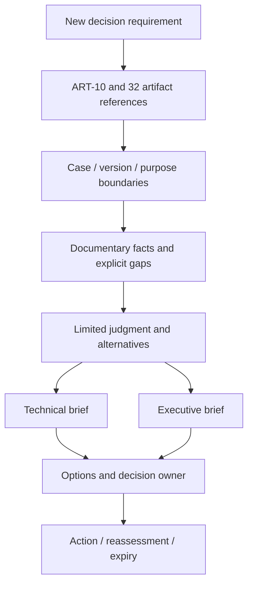

# 第29章　統合ケーススタディ

## この章の位置付け

本章は攻撃手順の集大成ではない。判断、許可、観測、検知、対応、分析を、**何を根拠に、どこまで結論できるか**で結ぶ章である。第1章の`ART-10 Integrated Security Case Map`を中心に、`ART-01`〜`ART-32`の入力と出力を辿り、`ART-33 Final Security Decision Portfolio Index`を作る。

Portfolio（ポートフォリオ）は成果物の束と索引であり、全項目の合格証ではない。全欄が埋まっていても、観測不足、未配達、保留、残余リスクは残り得る。供給例は、再開や完了を提案する根拠が不足することを明示した、判断前の`Decision ready`である。実務対象の安全性や本書のRelease完了を認定しない。

## 学習目標

- 統合ワークフローを実行できる
- 成果物間の追跡性を示せる
- 最終ポートフォリオを完成できる

ここでの実行は、固定された完全合成記録を読み、記入・比較することを指す。実環境の作業、実モデルや外部APIの呼出しは含まない。

## 前提知識

第1章の判断ループ、各章のArtifact、Case ID、版、Evidence、Source、Owner、再評価の区別を前提とする。迷った場合は[最小読解ガイド](../cases/first-artifact-walkthrough.md)から[ART-10空Template](../templates/integrated-security-case-map.md)と[第1章の完全合成Case](../cases/ch01-integrated-security-case-example.md)へ戻る。全Templateを暗記する必要はない。

第II部・第III部・第IV部で扱う別対象や独立Caseを、一つの実施履歴へ変換しない。[成果物索引](../artifact-index.md)が各Artifactの説明元とTemplateへの入口である。

## 本章が所有する範囲

- **OWN:** 最終判断要求、成果物の参照用途、Case・版・状態の非継承、二つのBrief、Gap・担当・期限・再評価、最終Rubric。
- **BRIDGE:** 第0〜28章のArtifactと付録。各章の判定条件は元章が所有し、本章で単一のStatusやScoreへ置換しない。
- **DELEGATE:** 実環境評価、実Incident対応、実在Actor帰属、製品固有操作。例えば[Pentest専門書](https://itdojp.github.io/pentest-learning-book/)は操作の深掘り先だが、読むこと自体は実施許可ではない。本章の課題は外部の実習なしで完結する。

## 導入ケースまたは判断要求

架空の請求書連携Service `billing-bridge.example`を扱う`CASE-2026-001`には、過去の判断`DEC-2026-001`と再評価`REA-2026-001`がある。第1章のDocumentは`Reassessment Due`、過去侵害の仮説`TH-2026-003`は`Inconclusive`である。この履歴を書き換えて現在の安全確認にしない。

新しい教材上の問い`DR-CAP29-001`は、「供給資料だけを根拠に、実作業再開または全Control完了を提案してよいか」である。架空の判断担当は`SYNTH-CTO`、期限は2026-10-22T00:00:00Z。教材の参照時点は2026-10-21T00:00:00Zとする。これは新しい読み取り記録の時点であり、7月の判断期限、親章の許可期間、原典の公開日を更新しない。

判断候補は、保留して不足条件を返す、再開を提案する、全Control完了として閉じる、の三つ。今回の資料には新しい許可と同対象版の実効果確認がないため、後二つを選べない。保留は作業放棄ではない。何が不足し、誰が、どの条件を次に確認するかを渡す判断である。

## 1. 最初に書く欄を固定する

[ART-33空Template](../templates/final-security-decision-portfolio-index.md)の「0. Portfolio identity」へ、Portfolio ID、Final Case ID、版、Owner、参照時点、期限を記入する。次に「1. Decision Requirement」へ問いと判断条件を書く。最初から32行を埋めて、後から目的を付けない。

### T-29-01　最初の三つの記入

| 記入先 | 供給例の値 | 自己点検 |
|---|---|---|
| Portfolio ID / Final Case ID | PORT-CAP29-001 / CASE-2026-001 | 記録IDとCaseを区別したか |
| Decision Requirement | DR-CAP29-001 / 再開・完了を提案できるか | 過去DR-2026-001を上書きしていないか |
| Owner / deadline | SYNTH-PORTFOLIO-OWNER / 2026-10-22T00:00:00Z | 作成担当と判断担当SYNTH-CTOを区別したか |

NIST CSF 2.0は高位のOutcomeを共有する枠組みであり、実装方法や実施順を指定するものではない。本章では技術担当と判断担当の情報の往復という限定観点を使う。以下の十二段階やPortfolioの六状態は本書の教材契約である。`SRC-CSF-001`

## 2. 同じCaseと同じ証拠を混同しない

参照はArtifact種別、Record ID、Case、対象、版、時点、用途で識別する。親版はSHA-256でも固定するが、hash一致は内容の真正性や有効性の証明ではない。Caseが同じでも新しいApp・版の例に親Evidenceを移すことはできない。

関係は`refines / supports / contradicts / supersedes / independent`を、何に対する関係かと併記する。本章の32行は最終Caseに対する`refines`または`independent`である。`refines`にも方法参照があり、EvidenceやAuthorityの転送を意味しない。別Caseの`CASE-2026-025`や`CASE-OS24-001`、独立学習Case、Web/API Caseは`independent`のまま収録する。

ART-04とART-23は同じFinding/Retest Bundle、ART-07とART-26は同じTimeline/RCA Bundleを別の役割で読む。重複Record IDを見つけても、異なるArtifact種別を消してはならない。逆に同じ記事・同じ原典を複数の独立観測へ増やしてはならない。

## 3. 十二の接続点で不足を渡す

### F-29-01　参照から判断まで



矢印は記録の追跡方向であり、攻撃・収集・実対応の実行順ではない。Inputは親資料の固定版、Outputは限定判断と不足条件である。元資料のStatusや未配達を越えて情報を渡さない。

### T-29-02　全成果物の読解経路

| 段階 | Artifact | 確認する接続と止める取り違え |
|---|---|---|
| S29-01 目的 | 01 / 10 / 14 | 学習計画と業務Caseを区別し、能力認定へ転用しない |
| S29-02 許可 | 02 / 13 / 18 | Draft、Conditional、Lab状態を新しい許可へ昇格しない |
| S29-03 資産・観測仮説 | 03 / 15 / 16 / 19 | 必要Evidenceと収集済みEvidence、候補発見とScope追加を分ける |
| S29-04 優先度・評価 | 11 / 17 / 20 / 21 / 22 | 固定公開Snapshotと合成対象、別Case、対象版を分ける |
| S29-05 Finding・Retest | 04 / 23 | 受容経由Closedと修正後Passed、独立対比と時系列を分ける |
| S29-06 Telemetry・Detection | 05 / 24 | fixtureのValidatedを実配備や全Control合格にしない |
| S29-07 Hunt・Incident | 06 / 25 | SupportedをDeclaredへ自動変換しない |
| S29-08 Timeline・原因 | 07 / 26 | 遅着、cutoff、相関、原因unresolvedを残す |
| S29-09 Control・改善 | 27 / 28 | Indeterminate、Partial、受容、Retiredを区別する |
| S29-10 要求・Source | 29 / 30 | 方法参照、独立Case、未収集、同一原典を区別する |
| S29-11 分析・Brief | 08 / 09 / 12 | CASE025の限定判断と未配達を保持する |
| S29-12 AI・再評価 | 31 / 32 | モデル内許容やClaim採用を実効果・受領にしない |

[全欄Case](../cases/ch29-capstone-portfolio-example.md)は各行から空Templateと元記入例へ戻れる。32行の`nativeState`は範囲付きの代表欄で、全Bundle共通の状態ではない。ART-01は独立の集約Statusを供給しておらず、月次レビュー日を示す。ART-14のGap identifiedをART-01へコピーしない。`integrationOwner`は今回の読解担当であり、親記録の担当を交代させない。元のOwner、Evidence、Decision、Reassessmentの詳細はリンク先の記録に保持する。

## 4. 何が証拠不足かを四つに分ける

`DOC-CAP29-01`〜`04`は、固定した親文書の行を読んだという教材内の記録である。新しいシステム観測ログではない。三つの確認事実と一つの独立Productの状態から、今回の提案条件を評価する。

- `GAP-CAP29-01`: 新しい許可が**Not collected**。RoE Draftや過去Conditionalは現在の実施許可ではない。
- `GAP-CAP29-02`: 過去の侵害仮説は**Inconclusive**。既存観測では結論できないことを表す。新しい実装の未観測はNot collectedであり、両者を同じ観測結果としない。
- `GAP-CAP29-03`: 原因未確定、未評価層、受容、Retestの**Residual risk**。記入完了で実務側の不足を解消しない。
- `GAP-CAP29-04`: 独立CaseのProductを根拠として受領した記録は**Not collected**。親のprepared-not-deliveredやplanned-not-receivedを維持する。

悪い例は「ART-05がValidatedなので現在の監視は十分」「ART-28がAcceptedなので修正済み」「ART-32にAcceptがあるのでART-33で受領済み」である。いずれも対象、版、意味、担当判断の少なくとも一つを飛ばしている。

良い例は「固定fixtureの検知結果は参照できるが、今回の実装・配備・許可の根拠は供給されていない。保留案とGAP01/02の確認条件を渡す」である。正常変更や資料遅延という代替説明も残し、悪意や主体帰属を足さない。

## 5. 同じ判断を二つのBriefへ変える

技術担当向けは、親版、参照ID、不足欄、確認条件を先に示す。判断担当向けは、選択肢、保留の理由、遅延の影響、残余リスク、担当・期限を先に示す。両者は`AJ-CAP29-001`、同じ四つのDOCと四つのGapを参照し、確信度と許容結論を変えない。

供給例の確信度「高」は、**供給資料では再開・完了の条件が不足するという限定判断**に対するもの。現在の実システムの安全性や過去侵害の有無への確信度ではない。AIの自己申告した自信でもない。

NIST SP 800-30 Rev.1の§3.3は評価結果と根拠の共有、§3.4は変化を踏まえた維持を扱う。本章では読者別説明と再評価の参考に限定する。連邦向け過程を普遍的な法的義務、本書六状態の規範算法、実許可の認定にしない。`SRC-NIST-RISK-001`

## 6. Portfolioの六状態を使う

### T-29-03　Portfolio Status

| Status | この教材での意味 | してはいけない読み替え |
|---|---|---|
| Assembling | 必須の参照・欄を組み立てている | 収集を実行している |
| Reviewable | 参照と不足を記録し、必要なレビューを待つ | 全項目Pass |
| Needs evidence | 選びたいOptionの根拠条件が不足する | 不足を空欄にして進める |
| Decision ready | レビューと条件を踏まえ、限定したOptionを判断者へ提示できる | 承認済み・実操作可能 |
| Approved | 同じCase・版・Decisionに対する承認記録がある | 別対象の許可、親Control合格 |
| Superseded | 後続版への置換関係を記録した | 過去の不足・誤りを削除する |

供給Caseは保留案なので、Open GapがあってもDecision readyに到達できる。再開案へ変えると必要な許可・観測が不足するためNeeds evidenceとなる。単にStatus文字列を変えても、この供給版の検査には通らない。

六状態の有限対比は状態の意味を説明する小さな比較であり、任意Portfolioを承認するWorkflow engineではない。今回の閉Schemaは一つの固定記入例を扱い、approvalとreceiptはnull、実行・配送は0である。

## 安全な演習または分析課題

Purposeは、根拠が不足する提案を止め、次の確認条件まで書くこと。Prerequisiteは第1章のCaseと本章のTemplateを読むこと。Authority / Scopeは供給合成資料の読み取りと自分のメモだけ。実対象、実Credential、実PII、外部Network、実Model APIは使わない。

Expected evidenceは、32参照行、十二接続点、四つのDOC、四Gap、二Brief、保留案、四Action、一再評価の対応である。Impactは自分の作業メモに限定する。実Data、未知の入力、版不一致、Scope不明、外部接続要求、未配達の受領扱いを見つけたらStopし、元章へ戻る。Cleanupでは自分のメモだけを整理し、親記録や供給教材を改変・削除しない。

1. Templateのidentityと判断要求を記入する。
2. 全欄Caseの32行から、ART-10、02、05、09、32を順に開く。Case、版、状態の対象範囲を口頭またはメモで説明する。
3. 四つのDOCの元行へ戻り、システム観測と文書の読解を区別する。
4. 四Gapの担当、期限、次の確認を記入する。Not collectedをInconclusiveへ変えない。
5. 二Briefを別々に書き、同じ判断・根拠・Gapを保持したか比較する。
6. 保留案の利点、遅延、可逆性を記す。再開案と完了案を今回選べない理由を説明する。
7. 再評価Triggerと期限を置き、元章へ戻る箇所を確認する。

### 任意のオフライン照合

Repositoryと既存の固定依存を準備済みの場合だけ、Repository rootで次を実行できる。合成教材の契約検査であり、外部対象や実モデルは使用しない。依存をこの演習から新規取得する手順ではない。失敗時は生成・公開へ進まず、変更した作業コピーの差分を確認し、教材の所有Issueへ戻す。

```bash
python3 scripts/check_chapter29_contract.py
```

期待値は`Chapter29 contract passed`、32参照・12段階・4DOC・4Gap・8レビュー観点、共有Policy 1.2.0 / Projection 1.1.0である。未知欄、親版漂流、別Case Evidence転送、未配達の受領化、一般的な危険記述は失敗する。自分の記入がすべての実務条件を満たすことを判定するコマンドではない。

## 作成する成果物と自己点検

空Template、[全欄Case](../cases/ch29-capstone-portfolio-example.md)、[非実行JSON](../cases/fixtures/ch29-capstone-portfolio.json)、[閉Schema](../schemas/ch29-capstone-portfolio.schema.json)を一組として読む。JSONが機械可読記録、Caseが全欄の読解表、Templateが記入用である。

- [ ] 何を判断するかをDR-CAP29-001から説明できる。
- [ ] ART-10の歴史と今回のART-33を区別し、旧期限を進めていない。
- [ ] 32種を辿り、同Bundle二役割と独立Caseを保持した。
- [ ] 欠測、観測後の結論不能、残余リスク、未配達を分けた。
- [ ] 二BriefのEvidence、Gap、判断、確信度の範囲が一致する。
- [ ] 保留を選ぶ理由、担当、期限、再評価条件、戻り先がある。

## 評価基準

八観点を各0〜2点で評価する。0は欠落・不正転用、1は参照はあるが条件や限界が説明できない、2は参照・限界・次の判断を辿れる状態。合計点で重大な欠陥を相殺しない。

| 観点 | 2点を説明する証拠 |
|---|---|
| 技術的正確性 | 対象・版・状態の意味を元章へ戻して説明する |
| 安全・法・倫理 | Authorityと実操作を区別し、停止条件を示す |
| 出典・鮮度 | SRCと事案内Evidenceを区別し、版・cutoff・変更Triggerを残す |
| 分析品質・不確実性 | 事実、判断、仮定、予測、推奨、代替説明、Gapを分ける |
| 教育的明確さ | 最初の記入欄、期待出力、自己点検、戻り先がある |
| 責任境界・追跡性 | 32種の役割と非継承を説明し、親判断を変更しない |
| 再現性・決定性 | 固定入力と生成・配布物が一致し、変更時に再検証する |
| 出版・利用可能性 | リンク、検索、表示、印刷、Edit先を確認する |

供給Case内の八レビューは**架空の記入例**であり、この書籍の独立レビューや人間の試行の証拠ではない。本書の公開判断は別途、P0/P1・blocking P2・未解決Thread 0、全QA、通常merge、実公開の確認を要する。法務承認や実読者試行の未実施をAIレビューで置換しない。

## よくある誤解

「33成果物があるから完成」ではない。入力、判断、担当、期限、限界を辿れなければ件数が揃っていても不十分である。「最新Sourceを確認したから過去の承認も更新」でもない。「保留だから成果物未完成」とも限らない。記録の完成と、実Controlの有効性、実務での承認は別の軸である。

## 章のまとめ

統合とはすべてを同じ状態にすることではなく、異なる成果物の意味を保持して判断へ渡すことである。本章の到達点は、保留を含む選択肢、不足、残余リスク、担当と再評価まで記録できることにある。

## 次に学ぶこと

[成果物索引](../artifact-index.md)と[Quick Start](../quickstart.md)へ戻る。[付録Bの記入先索引](../appendices/appendix-b-templates.md)、[付録Cのチェックリスト](../appendices/appendix-c-checklists.md)、[付録Iの評価対応](../appendices/appendix-i-rubric.md)へ戻り、元Templateと章の基準を照合する。最終整合と全書Releaseは第29章の実装だけでは完了しない。[読書ガイド](../manuscript/00-reading-guide.md)で自分の役割へ戻り、未達の確認条件を次の学習計画へ反映する。

## 参考文献・Source Note ID

- SRC-CSF-001 — NIST CSWP 29 / CSF 2.0、2024-02-26。高位Outcomeと§5.1の情報の往復に限定。
- SRC-NIST-RISK-001 — NIST SP 800-30 Rev.1、2012-09-17。§3.3の共有と§3.4の維持に限定。

[本章の限定Source確認](../references/ch29-source-review-2026-10-21.md)に採用箇所、取得byteのhash、未確認範囲を記録する。他章のSRCは各章へ戻って読むもので、本章の新しい観測Evidenceではない。
